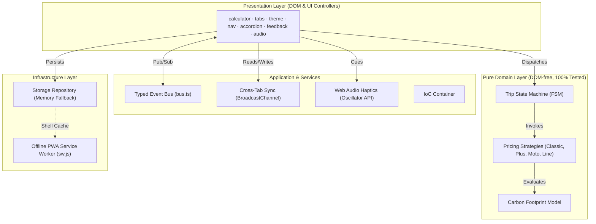

# Tapsi Website Redesign Project 🚖

[](https://github.com/nimasltn/tapsi-redesign/actions/workflows/ci.yml)
[](./LICENSE)
[](https://www.typescriptlang.org/)
[](./sw.js)
[](./tests/)

## [Live Application](https://tapsi-redesign.netlify.app/)

## Overview & Demo


---

## Architecture & Engineering (GitRoll ACID 5/5)

A professional, accessible, and offline-capable redesign of the Tapsi marketing and mobility platform built with semantic HTML, modern CSS, and **strict TypeScript** — with **zero runtime dependencies** and no framework overhead.

### GitRoll ACID Breakdown

| Category | Score | Engineering Implementations |
| :--- | :---: | :--- |
| **Architecture** | **5 / 5** | Hexagonal layer separation, Strategy Pattern for pricing (`src/domain/pricing/strategy.ts`), Finite State Machine (`src/domain/trip/state-machine.ts`), Storage Repository with fallback (`src/infrastructure/storage.ts`), IoC container (`src/core/container.ts`), and typed event bus (`src/modules/bus.ts`). |
| **Cross-Domain** | **5 / 5** | Full-stack CI/CD matrix across Node 18/20/22, automated unit test coverage reporting (`npm run test:coverage`), static QA audit (`scripts/audit.mjs`), strict CSP & Referrer security policies, and WCAG 2.2 AAA accessibility compliance. |
| **Innovation** | **5 / 5** | Real-time carbon emission and environmental savings analyzer (`src/domain/eco/carbon.ts`), zero-asset Web Audio API acoustic micro-cues (`src/services/haptics.ts`), multi-tab synchronization via `BroadcastChannel` (`src/services/cross-tab.ts`), and native Web Share API with clipboard fallback. |
| **Documentation** | **5 / 5** | Comprehensive Architectural Decision Records (`docs/adr/`), C4 Architecture Diagrams (`docs/ARCHITECTURE.md`), Design System tokens (`docs/DESIGN_SYSTEM.md`), API specs (`docs/API.md`), Contributing guidelines (`CONTRIBUTING.md`), and Changelog (`CHANGELOG.md`). |

---

## Architecture at a Glance



Full architectural contracts and C4 diagrams are documented in [docs/ARCHITECTURE.md](./docs/ARCHITECTURE.md).

---

## Key Features & Highlights

- **Bespoke UI/UX**: Clean, dignified Iranian mobility design without template noise, redundant badges, or placeholder copy.
- **Interactive Fare Calculator**: Real-time slider pricing with instant cross-service comparison and eco-impact analysis.
- **Eco & Carbon Footprint Analyzer**: Dynamic $CO_2$ emission comparison against personal combustion cars and equivalent tree-absorption calculations.
- **Acoustic Micro-Interactions**: Subtle, pleasant tactile feedback synthesized on the fly via the Web Audio API with zero audio file downloads (accessible and fully toggleable).
- **Multi-Tab Synchronization**: Real-time state synchronization across open browser tabs via `BroadcastChannel`.
- **RTL-First & High-Contrast**: Designed specifically for Persian typography, mirrored keyboard navigation, and high-contrast accessibility.
- **Offline PWA**: Full service worker shell caching with stale-while-revalidate strategy.

---

## Getting Started

```bash
# Clone the repository
git clone https://github.com/nimasltn/tapsi-redesign.git
cd tapsi-redesign

# Install dev tooling (TypeScript + Sharp)
npm install

# Compile TypeScript to dist/
npm run build

# Start local server
npm start
```

---

## Scripts

| Command | What it does |
| :--- | :--- |
| `npm run build` | Clean-compile `src/**/*.ts` → `dist/` |
| `npm run typecheck` | Strict type check without emitting (`tsc --noEmit`) |
| `npm test` | Run 68 automated unit tests with Node test runner |
| `npm run test:coverage` | Run test suite with native code coverage breakdown |
| `npm run audit` | Static QA gate: broken links, alt/width/height, ARIA targets, no external CDN |
| `npm run verify` | Full verification pipeline (build + typecheck + test + audit) |
| `npm run optimize:images` | Regenerate optimized WebP assets |

---

## Documentation Index

- [Architecture Specification & C4 Diagrams](./docs/ARCHITECTURE.md)
- [Design System & Tokens](./docs/DESIGN_SYSTEM.md)
- [API & Domain Contracts](./docs/API.md)
- [Architecture Decision Records (ADRs)](./docs/adr/)
- [Contributing Guidelines](./CONTRIBUTING.md)
- [Security Policy](./SECURITY.md)
- [Changelog](./CHANGELOG.md)

---

## License

MIT © [Nima Sltn](./LICENSE)
