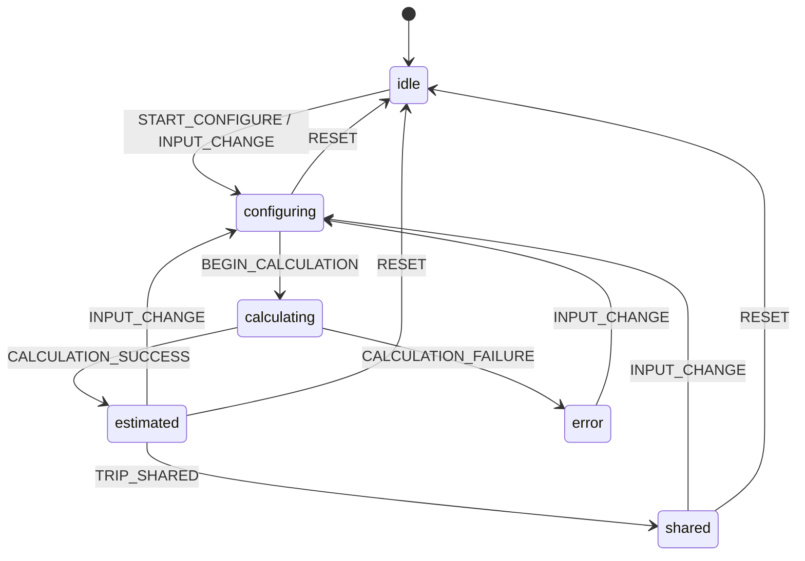

# API & Domain Specification 📑

This document specifies the contracts, public interfaces, domain models, and state machines implemented across the Tapsi architecture.

---

## 1. Event Bus API (`src/modules/bus.ts`)

The typed event bus provides decoupled pub/sub communication with Promise-backed execution guarantees.

### `EventMap` Specification

| Topic | Publisher | Payload Type | Description |
| :--- | :--- | :--- | :--- |
| `app:ready` | `main.ts` | `{ modules: string[]; failed: string[]; at: number }` | Emitted when boot completes |
| `nav:toggle` | `nav.ts` | `{ open: boolean }` | Mobile drawer toggled |
| `theme:change` | `theme.ts` | `{ theme: "light" \| "dark"; previous: string \| null }` | Document theme updated |
| `audio:toggle` | `audio.ts` | `{ enabled: boolean }` | Audio micro-cues enabled/disabled |
| `tabs:change` | `tabs.ts` | `{ id: string; panel: string \| null }` | Active service tab changed |
| `accordion:change`| `accordion.ts` | `{ id: string; expanded: boolean }` | FAQ accordion item expanded/closed |
| `carousel:change` | `carousel.ts` | `{ atStart: boolean; atEnd: boolean }` | Carousel rail scroll status updated |
| `calculator:change`| `calculator.ts`| `{ service: string; total: number }` | Trip price estimate recalculated |
| `eco:calculate` | `calculator.ts`| `{ service: string; carbonGrams: number; savedCarbonGrams: number }` | Carbon footprint evaluated |
| `trip:state` | `calculator.ts`| `{ from: string; to: string }` | Trip FSM state transition |
| `form:submit` | `form.ts` | `{ outcome: "valid" \| "invalid" \| "ignored"; errors?: Record<string, string> }` | Contact submission |
| `trip:share` | `calculator.ts`| `{ ok: boolean; via: "clipboard" \| "share_api" \| "fallback" }` | Trip share triggered |

---

## 2. Pricing Domain & Strategy Pattern (`src/domain/pricing/strategy.ts`)

### Mathematical Model
Fares are calculated using the formula:
$$\text{Fare} = \text{Round}_{1000}\Big(\big(\text{Base} + (\text{Distance}_{\text{km}} \times \text{Tariff}_{\text{km}}) + (\text{Duration}_{\text{min}} \times \text{Tariff}_{\text{min}})\big) \times \text{Multiplier}_{\text{time}}\Big)$$

### Service Tariffs
| Service Key | Label | Base (Toman) | Per Km (Toman) | Per Min (Toman) |
| :--- | :--- | :--- | :--- | :--- |
| `classic` | تپسی کلاسیک | 25,000 | 6,500 | 600 |
| `plus` | تپسی پلاس | 45,000 | 9,000 | 900 |
| `moto` | موتوپیک | 18,000 | 5,000 | 700 |
| `autopeyk` | اتوپیک | 30,000 | 7,000 | 500 |
| `line` | تپسی لاین | 20,000 | 4,500 | 400 |

### Demand Multipliers
- `day`: $1.00\times$
- `night`: $1.20\times$
- `peak`: $1.45\times$

---

## 3. Environmental & Sustainability Model (`src/domain/eco/carbon.ts`)

### Emission Benchmarks
- Private Combustion Automobile: $170\text{g CO}_2/\text{km}$
- Tapsi Classic / Plus: $135\text{g CO}_2/\text{km}$
- Tapsi Line (Carpool): $75\text{g CO}_2/\text{km}$
- Moto Courier: $60\text{g CO}_2/\text{km}$
- Autopeyk: $150\text{g CO}_2/\text{km}$

### Equivalent Tree Absorption
$$\text{TreeDays} = \frac{\text{Saved Carbon (g)}}{55\text{g / tree-day}}$$

---

## 4. Trip Finite State Machine (`src/domain/trip/state-machine.ts`)

