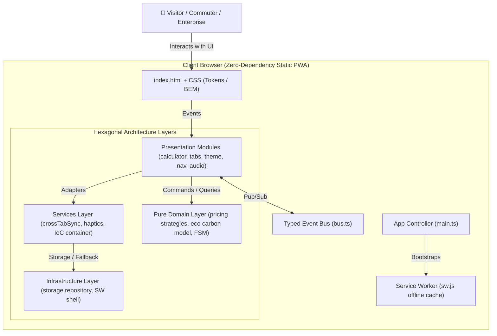
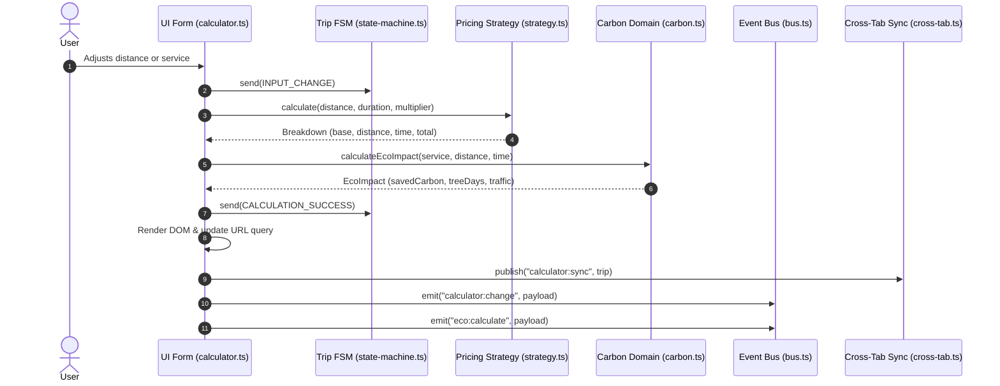

# Architecture Specification 🏛️

This document describes the software architecture, layer separation, domain models, and communication contracts governing the Tapsi Redesign.

---

## 1. High-Level C4 System Context



---

## 2. Layering & Architectural Boundaries

```
┌────────────────────────────────────────────────────────────────────────┐
│ Presentation Layer (UI Domains & DOM Controllers)                      │
│ - calculator.ts, tabs.ts, accordion.ts, theme.ts, nav.ts,              │
│   feedback.ts, form.ts, carousel.ts, reveal.ts, progress.ts, audio.ts  │
├────────────────────────────────────────────────────────────────────────┤
│ Application & Services Layer                                           │
│ - crossTabSync (BroadcastChannel multi-tab synchronization)            │
│ - haptics (Synthesized Web Audio API micro-interaction cues)           │
│ - container (Inversion of Control dependency container)                │
├────────────────────────────────────────────────────────────────────────┤
│ Typed Event Bus (bus.ts)                                               │
│ - Private lexical closure, Promise-settled emit, EventMap checking     │
├────────────────────────────────────────────────────────────────────────┤
│ Pure Domain Layer (DOM-free, 100% Node unit-testable)                  │
│ - pricing/strategy.ts (Strategy Pattern for multi-service tariffs)     │
│ - eco/carbon.ts (Carbon footprint & environmental offset model)        │
│ - trip/state-machine.ts (Deterministic lifecycle state machine)        │
│ - fare.ts, compare.ts, share.ts (Tariff calculations & URL coding)     │
├────────────────────────────────────────────────────────────────────────┤
│ Infrastructure & Data Layer                                            │
│ - storage.ts (StorageRepository with in-memory fallback & validation)   │
│ - sw.js (PWA service worker, versioned cache, stale-while-revalidate)  │
└────────────────────────────────────────────────────────────────────────┘
```

### Architectural Invariants & Rules

1. **Strict Decoupling of Presentation Domains**: UI modules never import sibling UI modules. Cross-domain notifications flow strictly through the typed event bus (`bus.ts`).
2. **Pure Domain Isolation**: Domain algorithms (`strategy.ts`, `carbon.ts`, `state-machine.ts`, `fare.ts`, `compare.ts`, `share.ts`) are completely DOM-free and side-effect free. They can be executed identically in browser runtimes and Node test runners.
3. **Resilience & Graceful Degradation**: Storage access, Web Audio API, View Transitions API, and BroadcastChannel automatically detect environment capabilities and fall back safely without exceptions.
4. **Defensive Booting**: `main.ts` initialises feature modules inside defensive error boundaries. A failure in an optional enhancement never disrupts core page functionality.

---

## 3. Data Flow: Reactive Fare Estimation & Eco Analysis



---

## 4. Multi-Tab Synchronization Flow

When a visitor has multiple tabs open (e.g., comparing fares in one tab while reading documentation in another):
1. User changes theme or calculates a trip in Tab A.
2. `crossTabSync.publish()` posts a lightweight payload to the shared `BroadcastChannel("tapsi_sync_channel")`.
3. Tab B receives the message via its `onmessage` handler.
4. Tab B silently applies the state without reloading or losing local scroll state.
5. In legacy browsers where `BroadcastChannel` is unsupported, the service falls back to the `window.storage` event.

---

## 5. Offline PWA Strategy

- **Installation**: Pre-caches the full application shell (all HTML, CSS, fonts, icons, and compiled JavaScript in `dist/`).
- **Navigation Requests**: Serves via Network-First, falling back instantly to cached `index.html` during network failure.
- **Code Assets**: Network-First with cached fallback to ensure updates land immediately without stale cache locks.
- **Cache Eviction**: Automated purge of legacy cache versions upon service worker activation.
